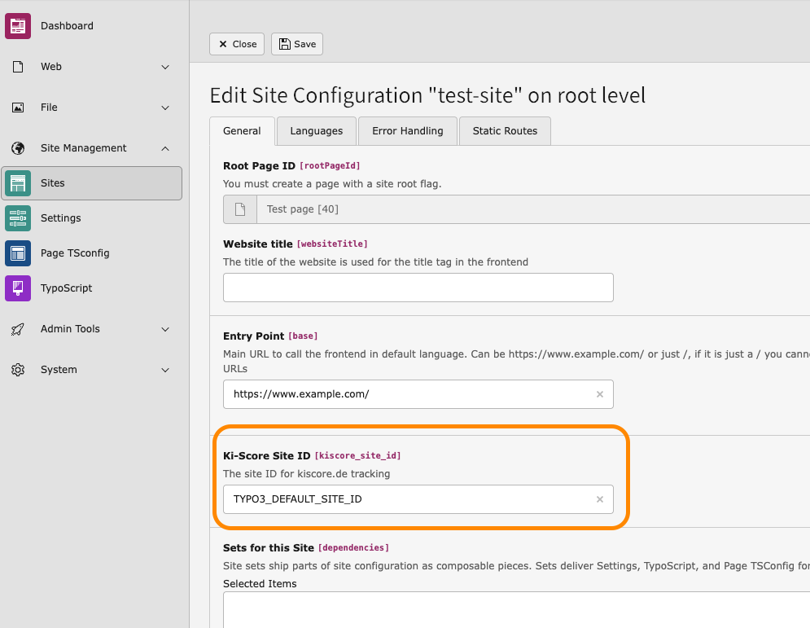

# Ki-Score TYPO3 extension

TYPO3 extension to integrate kiscore.ai, AI bot detection and analysis.

## Installation

```bash
composer require tpwd/typo3-kiscore
```

## Configuration

The extension tracks all frontend requests and sends them to kiscore.ai. It
only sends data once a connection key is set; the Ki-Score API rejects
requests without a matching tracking secret.

### Connection key

1. In the Ki-Score dashboard, open Settings > Traffic tracking > TYPO3 and
   copy the connection key
2. Go to the TYPO3 Site Configuration module and edit your site configuration
3. Paste the key into the field "Ki-Score Connection Key"
4. Save the configuration

To keep the key out of `config/sites/*/config.yaml`, reference an
environment variable instead:

```yaml
kiscore_connection_key: '%env(KISCORE_CONNECTION_KEY)%'
```

The separate fields "Ki-Score Site ID" and "Ki-Score Tracking Secret" of
version 2.0 (`kiscore_site_id`, `kiscore_tracking_secret`) keep working when
no connection key is set.

## Features

- Tracks all frontend requests (including cached pages)
- Sends user agent, referer, client IP and the page path with its `utm_*`
  parameters to kiscore.ai; other query parameters stay on your server, as
  they can hold tokens or email addresses
- Recognises visits referred by AI assistants via referer or `utm_source`
- Compatible with TYPO3 12, 13 and 14
- Minimal performance impact (short timeouts, errors never reach the visitor)

## Example



## Tests

This extension ships with a minimal PHPUnit setup to help increase software quality.

- Install dev dependencies:
  ```bash
  composer install
  ```
- Run the unit tests:
  ```bash
  composer test
  ```